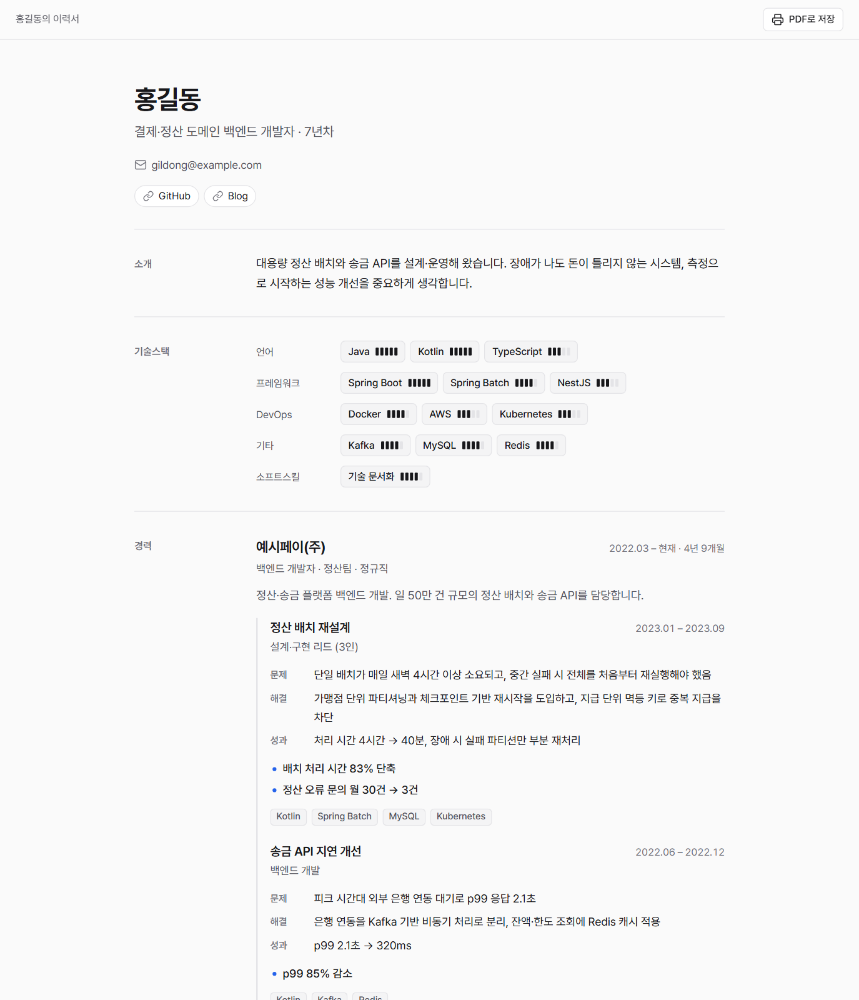
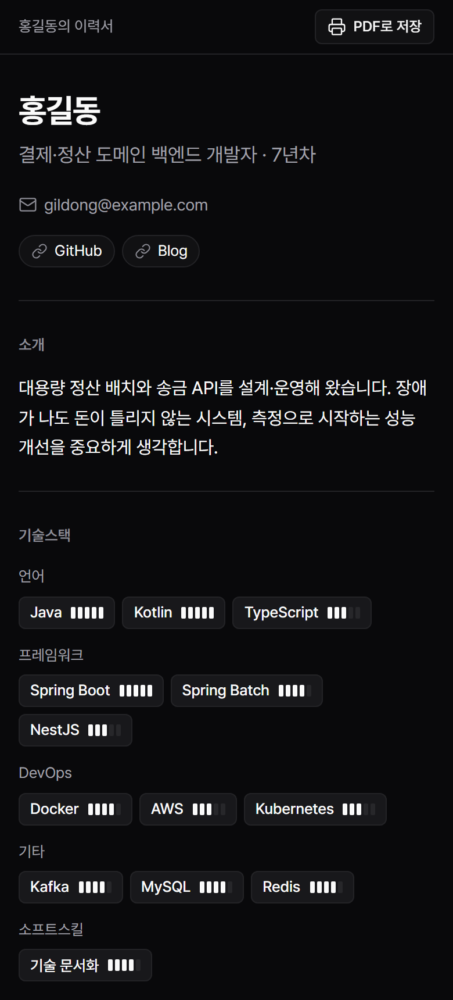
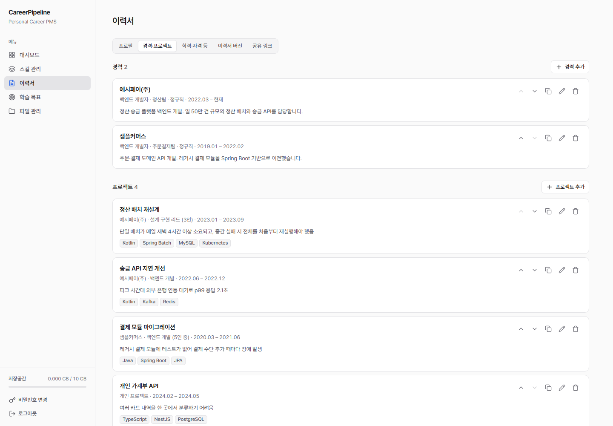
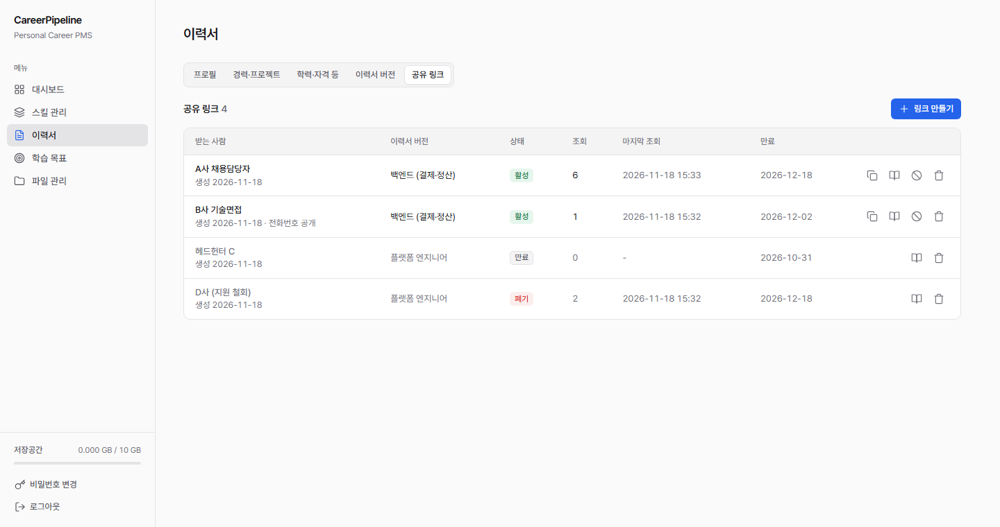
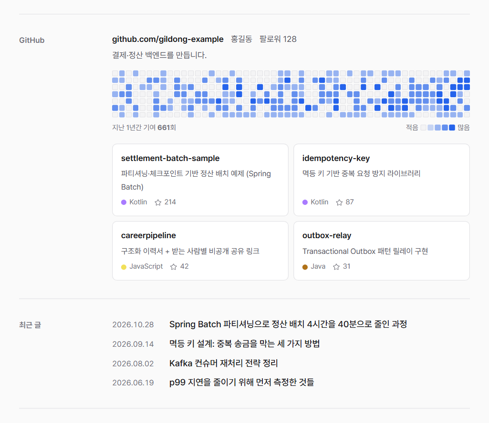
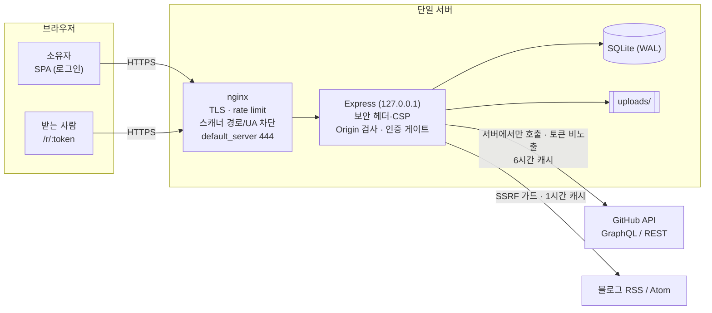

# CareerPipeline

**개인 이력·포트폴리오를 구조화해 관리하고, 받는 사람별 비공개 링크로 공유하는 셀프호스팅 커리어 관리 도구**


<p align="center">
  
  
</p>
<p align="center"><sub>받는 사람이 보는 한 장짜리 이력서. 데스크톱 라이트 / 모바일 다크. 스크린샷의 인물·회사·계정은 모두 가상 데이터입니다.</sub></p>

---

## 왜 만들었나

이직 준비를 할 때마다 같은 문제를 겪었습니다.

- **이력이 흩어져 있다.** 사람인, 잡코리아, 노션, 블로그, PDF 파일에 비슷하지만 조금씩 다른 이력서가 있고, 어느 것이 최신인지 알 수 없습니다.
- **버전과 선택적 공유가 어렵다.** 지원하는 직무에 따라 강조점을 바꾸고 싶지만, 문서를 복사하면 원본이 갈라집니다. 누구에게 어떤 버전을 보냈는지, 실제로 열어봤는지도 알 수 없습니다.
- **잡보드에는 이력서 API가 없다.** 결국 원본은 내가 들고 있어야 하고, 잡보드에는 붙여넣기만 할 수 있으면 충분합니다.

그래서 **구조화된 원본 데이터를 직접 보유**하고, 그 위에 직무별 버전과 받는 사람별 공유 링크를 얹는 방향으로 만들었습니다. 외부 SaaS에 개인정보를 맡기지 않도록 단일 소유자용 셀프호스팅으로 설계했습니다.

## 주요 기능

| 영역 | 내용 |
|---|---|
| **구조화 이력서** | 경력·프로젝트·학력·자격증·어학·수상·활동을 항목 단위로 저장합니다. 항목 구성은 사람인/잡코리아 입력 양식과 호환되게 잡았고, 각 항목은 텍스트로 복사해 잡보드 양식에 바로 붙여넣을 수 있습니다. |
| **경력 아래 프로젝트** | 프로젝트를 특정 경력에 연결하면 공개 화면에서 해당 회사 아래에 묶여 표시됩니다. 프로젝트는 **문제 / 해결 / 성과** + 정량 지표 + 기술 스택으로 기록합니다. |
| **직무별 버전** | 같은 원본에서 포함할 항목, 헤드라인, 자기소개만 바꾼 버전(예: "백엔드", "플랫폼 엔지니어")을 만듭니다. 원본은 하나로 유지됩니다. |
| **받는 사람별 비공개 링크** | 버전마다 받는 사람 단위로 링크를 발급합니다. 256-bit 랜덤 토큰, 만료일, 즉시 폐기, 전화번호 공개 여부, 열람 횟수·마지막 열람 시각·열람 로그를 제공합니다. 없는 링크·만료·폐기 링크는 모두 **동일한 404**를 돌려줍니다. |
| **공개 이력서 뷰** | 로그인 없이 열리는 한 장짜리 이력서입니다. 인쇄 스타일이 따로 있어 "PDF로 저장" 버튼으로 바로 PDF를 만들 수 있고, 인쇄본에는 링크 URL이 함께 찍힙니다. 소유자는 링크를 만들기 전에 미리보기로 확인할 수 있습니다. |
| **GitHub · 블로그 섹션** | GitHub GraphQL로 고정(pinned) 저장소와 1년치 기여 히트맵을 가져옵니다. 토큰이 없으면 REST로 폴백합니다(히트맵 없음). 블로그는 RSS 2.0 / Atom 피드에서 최근 글 5개를 보여줍니다. |
| **포트폴리오 파일** | 업로드한 파일은 기본 비공개이고, 명시적으로 공개를 켠 파일만 공유 화면에 노출됩니다. |
| **스킬 · 학습 목표** | 스킬 숙련도(1–5)와 변경 이력, 학습 목표와 학습 로그를 관리합니다. 스킬은 공개 이력서의 기술스택 섹션으로 이어집니다. |
| **계정 · 테마** | 비밀번호 변경(변경 즉시 기존 세션 전부 무효)을 지원합니다. 라이트/다크 테마는 시스템 설정을 따릅니다. |

<table>
  <tr>
    <td width="50%"></td>
    <td width="50%"></td>
  </tr>
  <tr>
    <td align="center"><sub>경력·프로젝트 편집. 프로젝트가 소속 경력과 함께 표시됩니다.</sub></td>
    <td align="center"><sub>공유 링크 관리. 받는 사람별 상태(활성/만료/폐기), 조회수, 마지막 열람, 만료일.</sub></td>
  </tr>
  <tr>
    <td colspan="2"></td>
  </tr>
  <tr>
    <td colspan="2" align="center"><sub>GitHub 섹션(기여 히트맵 + 고정 저장소)과 블로그 최근 글. 서버가 가져와 필요한 필드만 가공해 전달합니다.</sub></td>
  </tr>
</table>

## 아키텍처



- **백엔드**: Express 단일 프로세스. 앱은 `127.0.0.1`에만 바인딩하고 외부 노출은 nginx가 담당합니다.
- **저장소**: SQLite(WAL) 파일 하나와 업로드 폴더 하나. 백업 대상이 두 개뿐입니다.
- **프론트엔드**: 빌드 단계 없는 Vanilla JS. 소유자용 SPA(`public/index.html`, `app.js`)와 공개 이력서 페이지(`public/r.html`)가 분리돼 있습니다.
- **외부 연동**: GitHub와 RSS는 브라우저가 아니라 서버가 호출합니다. 받는 사람의 브라우저는 외부 도메인에 요청하지 않고, 토큰도 서버 밖으로 나가지 않습니다.

### 공개 링크 요청 흐름

1. `GET /r/<token>`: 인증 게이트는 정확한 토큰 형식(base64url 43자)과 일치하는 경로만 통과시킵니다. 토큰이 유효(존재 + 미폐기 + 미만료)하면 `200`, 아니면 같은 페이지를 `404`로 응답합니다.
2. 페이지가 `GET /api/public/<token>`을 호출합니다. 서버는 링크를 다시 검증한 뒤 **화이트리스트 빌더**(`buildView`)로 응답을 조립합니다. GitHub/RSS 조회는 DB 조회와 병렬로 진행되며, 실패하면 해당 섹션 키 자체가 빠집니다.
3. 유효한 열람만 `share_views`에 시각·IP·User-Agent로 기록합니다.
4. 클라이언트는 모든 값을 이스케이프하고, 링크는 `http(s)`만 허용해 렌더링합니다.
5. 공개 파일은 `GET /api/public/<token>/files/<uuid>`로만 접근하며, 매번 링크 유효성과 파일 공개 여부를 함께 확인합니다.

## 보안 설계

개인정보(연락처, 경력)를 인터넷에 노출하는 서비스라서 기능보다 보안에 더 많은 시간을 들였습니다. 원칙은 세 가지입니다. **기본은 비공개**, **공개는 화이트리스트로**, **실패하면 덜 보여준다**.

### 인증과 세션

| 위협 | 대응 | 위치 |
|---|---|---|
| 설정 누락으로 무인증 기동 | `AUTH_USER`, `AUTH_PASS_HASH`(scrypt), 32자 이상 `SESSION_SECRET` 중 하나라도 없으면 **서버가 기동을 거부** | `server.js` |
| 비밀번호 유출 | scrypt(salt 16B, 64B 키) 해시만 저장. 비교는 `timingSafeEqual` | `server.js`, `scripts/hash-password.js` |
| 세션 탈취·위조 | 서버 저장소 없는 무상태 쿠키 `user\|expiry\|HMAC`. HMAC 입력에 **현재 비밀번호 해시**를 포함해, 비밀번호를 바꾸면 기존 세션이 전부 무효화됩니다. `HttpOnly`, `Secure`(localhost 제외), 7일 만료 | `server.js` |
| 무차별 대입 | IP당 5회, 전체 100회 실패 시 15분 잠금. 검증 **전에** 먼저 카운트해서 동시 요청으로 한도를 우회할 수 없습니다. nginx에서도 로그인 경로를 분당 5회로 제한 | `server.js`, nginx |
| CSRF | 쿠키 `SameSite=Strict` + 상태 변경 요청에서 `Origin`이 있으면 `Host`와 일치해야 함 | `server.js` |
| 비공개 경로 노출 | 인증 게이트 뒤에 정적 파일을 둡니다. 공개 예외는 `/login`, `/style.css`, 그리고 토큰 형식과 **정확히** 일치하는 공유 경로뿐입니다 | `server.js` |

### 공개 화면

| 위협 | 대응 |
|---|---|
| 민감 필드 유출 | 공개 응답은 "민감한 필드를 지우는" 방식이 아니라, **필요한 필드만 골라 담는 화이트리스트 빌더**로 만듭니다. 주소·생년월일은 코드 경로상 포함될 수 없고, 전화번호는 링크별로 켠 경우에만 들어갑니다. 저장된 항목도 출력 시 입력 검증과 같은 스키마로 다시 거릅니다. |
| 링크 존재 여부 추측 | 256-bit 토큰(`crypto.randomBytes(32)`). 없음/만료/폐기를 상태 코드와 본문까지 동일한 404로 응답해 구분할 수 없게 했습니다. |
| XSS | `innerHTML`에 들어가는 모든 값은 `esc()`, 인라인 핸들러 인자는 `jsArg()`(JSON 문자열화 후 이스케이프)를 거칩니다. 외부에서 가져온 URL은 `http(s)`만 렌더링합니다. |
| 공개 파일을 통한 공격 | Content-Type은 저장된 MIME이 아니라 **확장자에서 다시 도출**합니다. PDF와 이미지만 인라인으로 열리고 HTML·SVG를 포함한 나머지는 다운로드를 강제합니다. 응답에는 `CSP: sandbox`와 `Cache-Control: private, no-store`를 붙입니다. |
| 검색 노출·리퍼러 유출 | `X-Robots-Tag: noindex`, `robots.txt` 전체 차단, 공개 페이지에 `referrer: no-referrer` |
| 공통 헤더 | CSP(`default-src 'self'`, `frame-ancestors 'none'`, `object-src 'none'`), `X-Frame-Options: DENY`, `nosniff`, `Referrer-Policy: same-origin`, `x-powered-by` 제거 |

### 외부 연동 (GitHub, RSS)

- **SSRF 가드**: RSS URL은 `https`만 허용합니다. 호스트를 DNS로 해석한 **모든 주소**를 사설·루프백·링크로컬·CGNAT·`0.0.0.0/8`·IPv6 ULA 대역과 대조하고, IPv4-mapped IPv6(`::ffff:127.0.0.1`)도 같은 규칙으로 막습니다. 리다이렉트는 자동으로 따라가지 않고, 최대 3회까지 **매 홉마다 재검증**합니다. 응답은 2MB, 8초 타임아웃으로 제한합니다.
- **GitHub 토큰 격리**: 토큰은 `api.github.com`으로만 전송하고 리다이렉트는 오류로 처리합니다. 응답은 이름·설명·별 수 같은 필드만 골라 가공하며, 비공개 저장소는 한 번 더 걸러냅니다. 로그에는 URL과 토큰을 남기지 않습니다.
- **장애 격리**: 성공 결과는 캐시(GitHub 6시간, RSS 1시간)하고, 실패하면 오래된 캐시를 쓰거나 섹션을 생략합니다. 실패 후 10분 동안은 재시도하지 않아 공개 페이지가 외부 타임아웃에 묶이지 않습니다.

### 인프라 (nginx)

<details>
<summary>nginx 하드닝 상세 (<code>deploy/nginx/</code>)</summary>

- 일반 요청 IP당 초당 10회(burst 40), 로그인 분당 5회(burst 5), 초과 시 `429`
- 알려진 스캐너 User-Agent(sqlmap, nikto, nuclei 등)와 빈 UA는 `444`(응답 없이 연결 종료)
- `.env`·`.git` 같은 dotfile, `.php`·`.bak`·`.yml` 등 서버 스크립트·설정 확장자, `wp-admin`·`phpmyadmin` 같은 스캐너 경로는 `444`
- IP 직접 접근이나 알 수 없는 Host는 `default_server`에서 `444`, TLS는 `ssl_reject_handshake`로 거부
- `server_tokens off`, HSTS
- 앱은 `127.0.0.1`에만 바인딩. Express는 `trust proxy`를 루프백으로 한정해 클라이언트 IP를 판단합니다.

</details>

### 알려진 한계

- **링크는 전달되거나 캡처될 수 있습니다.** 토큰 기반 공유의 본질적 한계입니다. 받는 사람별 링크, 만료, 즉시 폐기, 열람 로그로 사후 관리하는 방향을 택했습니다.
- **DNS rebinding 창이 남아 있습니다.** SSRF 검증 후 `fetch`가 DNS를 다시 조회하므로, 그 사이에 응답이 바뀌면 검증을 우회할 여지가 있습니다. 검증한 IP로 연결을 고정하면 막을 수 있습니다(코드에 `ponytail:` 주석으로 표시).
- **CSP가 `script-src 'unsafe-inline'`을 허용합니다.** 인라인 이벤트 핸들러를 쓰고 있기 때문이며, XSS 방어는 출력 이스케이프(`esc`/`jsArg`)에 의존합니다.
- **로그인 실패 카운터와 외부 연동 캐시는 프로세스 메모리에 있습니다.** 재시작하면 초기화되고, 단일 프로세스를 전제로 합니다.

## 기술 스택과 설계 원칙

| 구분 | 사용 |
|---|---|
| 런타임 | Node.js (내장 `fetch`, `crypto.scrypt`, `net.BlockList`, `node:test`) |
| 서버 | Express 4, multer(업로드), dotenv, uuid |
| DB | SQLite3 (WAL, 외래키 ON) |
| 프론트엔드 | Vanilla JS + CSS 변수 테마, 인라인 SVG 아이콘, Pretendard 폰트 |
| 운영 | nginx(리버스 프록시·TLS), 프로세스 매니저(pm2 등) |

- **의존성을 늘리지 않는다.** 위 런타임 의존성 외에는 추가하지 않았습니다. 해싱, HMAC, SSRF 대역 검사, RSS 파싱, 테스트를 모두 Node 표준 라이브러리로 처리합니다.
- **추가 전용 마이그레이션.** `CREATE TABLE IF NOT EXISTS`와 `ALTER TABLE ADD COLUMN`(중복 컬럼 오류만 무시)만 사용합니다. 기동할 때마다 재실행해도 안전하고, 운영 DB를 그대로 둔 채 배포할 수 있습니다.
- **스키마 하나로 입력과 출력을 함께 검증.** `resume-schema.js`의 필드 화이트리스트가 저장 시 입력 검증과 공개 출력 정화를 모두 맡습니다.
- **빌드 없는 프론트엔드.** 번들러·프레임워크 없이 정적 파일만 서빙하므로 배포는 `git pull` 후 재시작으로 끝납니다.

## 데이터 모델

| 테이블 | 용도 |
|---|---|
| `profile` | 단일 행(`id = 1`). 이름, 헤드라인, 소개, 연락처, 링크, GitHub 사용자명, RSS URL |
| `resume_items` | 이력 항목. `type`(experience / project / education / certification / language / award / activity) + `data`(JSON) + 정렬 순서 |
| `resumes` | 직무별 버전. 제목, 버전, 태그, 헤드라인·소개 덮어쓰기, `include`(NULL이면 전체, 아니면 포함할 항목 ID 목록) |
| `share_links` | 받는 사람별 링크. 토큰, 대상 버전, 라벨, 전화번호 공개 여부, 만료·폐기 시각 |
| `share_views` | 열람 로그. 링크 ID, 시각, IP, User-Agent |
| `files` | 업로드 파일 메타데이터. 원본 이름, 저장 이름, 크기, `is_public`(기본 0), 공개용 제목 |
| `skills` / `skill_histories` | 스킬과 숙련도 변경 이력 |
| `goals` / `learning_logs` | 학습 목표와 학습 기록 |
| `settings` | 키-값 설정. 변경된 비밀번호 해시(`pass_hash`) 저장 |

항목별 필드를 컬럼 대신 JSON으로 둔 이유는 유형이 7가지이고 필드가 계속 바뀌기 때문입니다. 대신 스키마 검증을 애플리케이션 한 곳(`resume-schema.js`)에 모았습니다.

## 실행 방법

Node.js 20 이상이 필요합니다(Node 24에서 테스트).

```bash
git clone https://github.com/Uari/CareerPipeline.git
cd CareerPipeline
npm ci
cp .env.example .env
```

`.env`에 로그인 정보를 채웁니다. 이 값이 없으면 서버가 기동하지 않습니다.

```bash
# 1) 비밀번호 해시 → AUTH_PASS_HASH
node scripts/hash-password.js '사용할-비밀번호'

# 2) 세션 서명 키 → SESSION_SECRET
node -e "console.log(require('crypto').randomBytes(32).toString('hex'))"
```

```bash
npm start   # http://127.0.0.1:3000 → /login
npm test    # node:test, 16개 테스트
```

`GITHUB_TOKEN`은 선택입니다. 공개 읽기 권한만 있는 fine-grained 토큰을 넣으면 GraphQL로 고정 저장소와 기여 히트맵을 가져오고, 없으면 REST로 폴백합니다(히트맵 없음, 시간당 60회 제한).

### 배포

`deploy/nginx/`에 실제로 쓰는 nginx 설정이 있습니다.

- `conf.d-security.conf` → `/etc/nginx/conf.d/` (http 컨텍스트: rate limit 존, 스캐너 UA 맵, catch-all `default_server`)
- `career-pipeline` → 사이트 설정. `server_name`과 인증서 경로를 자신의 도메인으로 바꿉니다.
- 사이트 설정이 include하는 `snippets/cp-proxy.conf`는 저장소에 없습니다. CSRF 검사(Origin과 Host 비교)와 IP별 잠금이 올바르게 동작하려면 최소한 아래 헤더를 넘겨야 합니다.

```nginx
proxy_set_header Host              $host;
proxy_set_header X-Forwarded-For   $proxy_add_x_forwarded_for;
proxy_set_header X-Forwarded-Proto $scheme;
```

앱은 pm2 같은 프로세스 매니저로 실행합니다(`pm2 start server.js --name career-pipeline`). 백업 대상은 SQLite 파일(`DB_PATH`)과 업로드 폴더(`UPLOAD_DIR`) 두 가지입니다. `healthcheck.sh`는 `/health`를 확인해 응답이 없으면 재기동하는 cron용 스크립트입니다.

## 테스트

외부 프레임워크 없이 `node:test`를 사용합니다. 각 스위트는 임시 DB와 업로드 폴더로 **실제 서버 프로세스를 띄워** HTTP로 검증합니다. 외부 네트워크는 쓰지 않으며, GitHub API는 루프백 스텁으로 대체합니다.

| 파일 | 검증 내용 |
|---|---|
| `test/auth.test.js` | 인증 설정 없을 때 기동 거부, 보안 헤더, 미인증 요청 차단, 6번째 연속 실패 시 429 잠금, 쿠키 변조 거부, CSRF(Origin 불일치) 차단, 로그아웃, 비밀번호 변경 시 기존 세션 무효화와 재시작 후 유지 |
| `test/feeds.test.js` | RSS 2.0 / Atom 파싱(CDATA, 엔티티, 태그 제거, 위험한 링크 제거), SSRF 가드(비 https, 사설·루프백·IPv4-mapped IPv6 차단) |
| `test/resume.test.js` | 프로필·항목 CRUD와 검증, 파일 공개 토글, 공개 뷰 화이트리스트(주소·생년월일 미포함)와 열람 로그, 전화번호 토글, 파일 Content-Type·sandbox·다운로드 강제, GitHub/블로그 필드 화이트리스트·토큰 비노출·실패 시 섹션 생략, 폐기·만료·임의 토큰의 동일 404, 소유자 엔드포인트 인증 요구 |

## 프로젝트 구조

```
server.js            인증·세션·보안 헤더·CSRF·인증 게이트, 라우터 마운트
db.js                SQLite 연결, 스키마 생성, 추가 전용 마이그레이션
resume-schema.js     항목·프로필 필드 화이트리스트 검증 (입력/출력 공용)
feeds.js             GitHub(GraphQL/REST) · RSS 수집, 캐시, SSRF 가드
routes/              profile · resume · share · files · skills · goals
public/              index.html + app.js (소유자 SPA), r.html (공개 이력서), login.html, style.css
scripts/             hash-password.js
deploy/nginx/        nginx 사이트 설정과 보안 설정
test/                node:test 스위트
```

## 로드맵

- **첫 열람 알림**: 링크가 처음 열리면 텔레그램/이메일로 알림
- **링크별 스냅샷**: 지금은 열람 시점의 최신 데이터를 보여줍니다. 링크 발급 시점의 내용으로 고정하는 옵션
- **DNS 고정 연결**: 검증한 IP로 RSS를 가져와 DNS rebinding 창 제거
- **CSP 강화**: 인라인 핸들러를 걷어내고 `script-src 'unsafe-inline'` 제거
